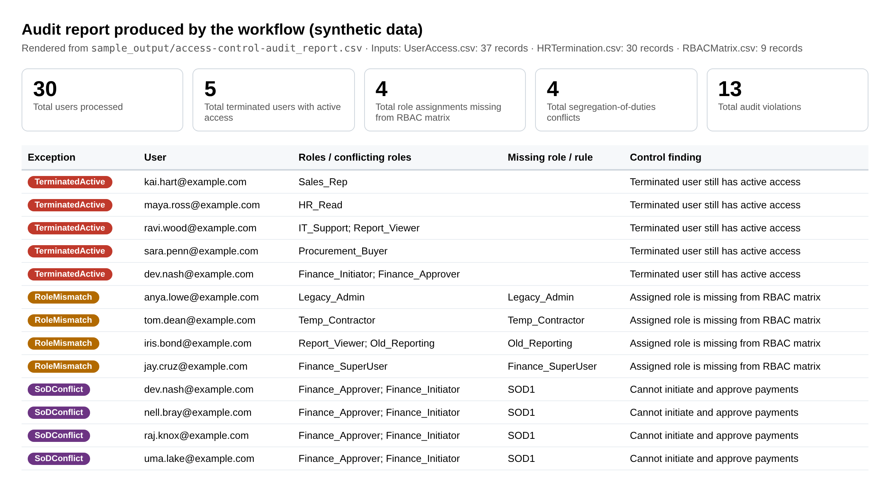
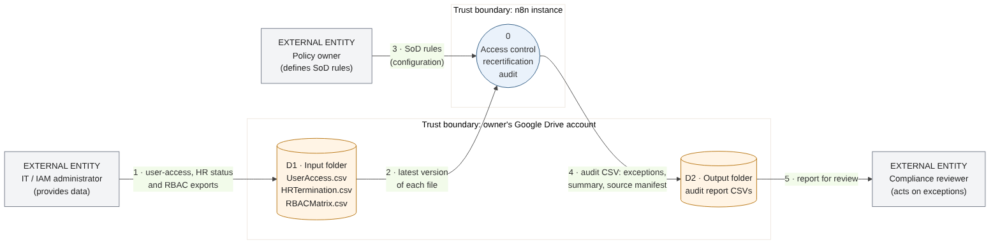
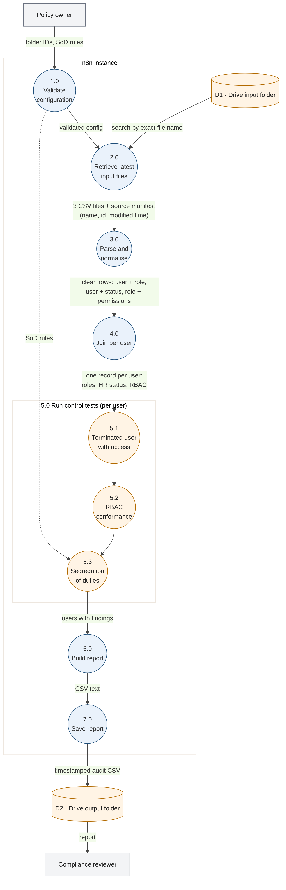
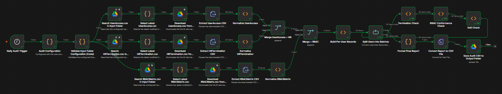
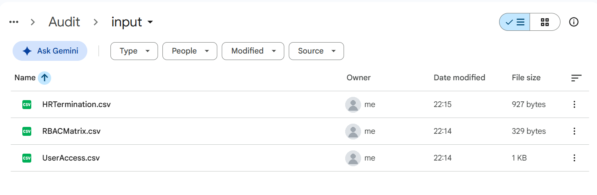
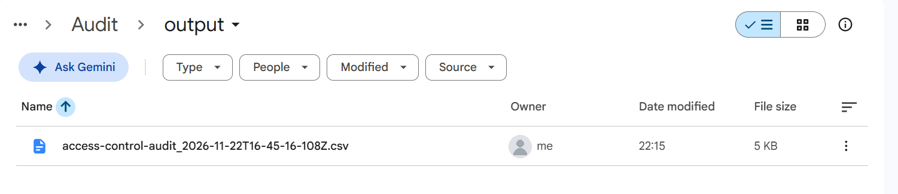

# 🔐 Access Control Recertification Audit: Automated IAM & UAR Pipeline


An **n8n workflow that automates user-access recertification (UAR) testing**. On every run it picks up the latest *user-access*, *HR status* and *RBAC matrix* CSV exports from a Google Drive folder, tests them against three access-control rules, and saves an **audit-style CSV exception report** for a human reviewer.

> **Portfolio project.** All data is synthetic (`example.com`). It demonstrates control-testing automation; it is not an audit or compliance assertion.



## 🎯 Problem
Periodic access reviews are a core IT general control (ISO/IEC 27001, SOC 2, HIPAA, SOX-style environments) but are often manual and spreadsheet-driven. Typical failures: **leavers who keep access**, **roles nobody approved**, and **users who can both initiate and approve** a transaction. This workflow runs those checks identically every time and leaves traceable evidence.

## ✅ Control tests

| # | Test | Raises an exception when… | Illustrative framework relevance* |
|---|---|---|---|
| 1 | **Terminated user with active access** | HR status is `Terminated` but roles are still assigned | ISO 27001:2022 A.5.18, A.6.5 · NIST CSF 2.0 PR.AA-05 · HIPAA §164.308(a)(3)(ii)(C) |
| 2 | **RBAC conformance** | An assigned role is not in the approved RBAC matrix | ISO 27001:2022 A.5.15, A.5.18 · NIST CSF 2.0 PR.AA-05 · HIPAA §164.308(a)(4) |
| 3 | **Segregation of duties (SoD)** | A user holds every role of a configured conflict rule (e.g. `Finance_Initiator` + `Finance_Approver`) | ISO 27001:2022 A.5.3 · NIST CSF 2.0 PR.AA-05 |

\*Educational mapping of what each test *relates to*, not a compliance claim.

## 🧭 Data flow

**Level 0: context**



**Level 1: processes** (the three control tests are shaded orange)



Everything stays inside the owner's own Google Drive account and n8n instance; no third-party service receives the data.

## 📸 Proof it runs
Real execution of this workflow in n8n against the files in [`sample_data/`](sample_data/):



| Input folder (Google Drive) | Output folder (Google Drive) |
|---|---|
|  |  |

**Result** (full file: [`sample_output/access-control-audit_report.csv`](sample_output/access-control-audit_report.csv)):

| Users processed | Terminated with access | Role not in RBAC | SoD conflicts | **Total violations** |
|---|---|---|---|---|
| 30 | 5 | 4 | 4 | **13** |

The report also records **input provenance** (file name, modified time, record count) and a run timestamp for every execution. Drive file IDs are redacted in the sample.

## ⚙️ How it works
1. **Schedule trigger** starts the run (adjust the schedule in n8n).
2. **Configuration + validation** fails fast if folder IDs or SoD rules are missing.
3. **Retrieve inputs**: for each of `UserAccess.csv`, `HRTermination.csv`, `RBACMatrix.csv`, search the input folder by exact name, select the **most recently modified** match, download it. A missing file **stops the run** instead of producing a stale report.
4. **Parse and normalise**: trim, lowercase, de-duplicate; tolerant of common header names (`User`/`Email`/`UPN`, `Role`, `Status`...).
5. **Join per user** (roles + HR status + RBAC) and loop over users applying the three tests; one user can raise several findings.
6. **Report**: exceptions, summary and source manifest → timestamped CSV → saved to the output folder.

## 🚀 Run it yourself
Requires an n8n instance and a Google account (Drive OAuth2 credential).

1. In Google Drive create two folders, e.g. `input` and `output`. Upload the three files from [`sample_data/`](sample_data/) to `input` (**file names must stay exactly** `UserAccess.csv`, `HRTermination.csv`, `RBACMatrix.csv`).
2. In n8n: *Import from file* → [`workflow/access_control_recertification_audit.json`](workflow/access_control_recertification_audit.json).
3. Open **Audit Configuration** and set `inputFolderId` and `outputFolderId` (the ID after `/folders/` in each folder's URL).
4. Select your **Google Drive OAuth2** credential on the seven Google Drive nodes (3 × search, 3 × download, 1 × save).
5. Click **Execute workflow**. A new `access-control-audit_<timestamp>.csv` appears in `output` (expect the 13 violations above).

To audit your own data, replace the three CSVs with exports using the same columns: `User, Role` · `User, Status` · `Role, Permission`. Edit `sodRules` in *Audit Configuration* to define your own conflict rules.

## 🔒 Data handling & security notes
- Repository contains **synthetic data only**; no real people, companies or systems.
- The exported workflow is **sanitised**: no credentials, instance ID or real folder/file IDs (placeholders must be replaced before use).
- Credentials live in n8n's credential store, never in the workflow file.
- For real use: restrict the Drive folders to the audit team, treat reports as confidential (they list who holds which access), and apply retention rules to old reports.

## ⚠️ Limitations
- Users **missing from the HR file** get status `Unknown` and are not flagged (orphan-account detection is future work).
- HR users with **no access rows** are not evaluated.
- Role comparison is by name (case-insensitive); no role hierarchy or permission-level analysis.
- One SoD rule ships by default; add more in `sodRules`.
- Output is an exception list for review; no approval, ticketing or notification step.

## 🗺️ Roadmap
Orphan-account and dormant-account tests · privileged-role review · manager attestation step · ticket per exception (ServiceNow/Jira) · email/Teams notification · severity scoring.

## 📁 Repository layout
```
workflow/       sanitised n8n workflow (importable)
sample_data/    3 synthetic input CSVs
sample_output/  report produced by a real run (Drive IDs redacted)
images/         screenshots and data flow diagrams
```

## 🛠️ Tech
n8n · JavaScript (Code/Function nodes) · Google Drive API (OAuth2) · CSV

## 👤 Author
**Prashant Pandey** · [GitHub](https://github.com/prashantpandey120143)

Licensed under the [MIT License](LICENSE).
